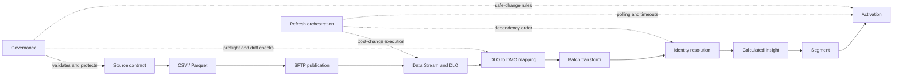

<div align="center">

# Salesforce Data 360 Skills for Codex

### From source files to activated audiences—safely, repeatably, and with evidence.

[](LICENSE)
[](https://www.salesforce.com/data/)
[](https://developers.openai.com/codex/skills/)
[](#project-status)

**A modular set of agent skills for designing, deploying, validating, and operating Salesforce Data 360 implementations.**

[MCP vs. skills](#the-levers-and-the-brain) · [What it does](#what-this-project-does) · [Install](#installation) · [How it works](#how-the-skills-work-together) · [Examples](#example-prompts) · [Safety](#safety-by-design)

</div>

---

## Why this exists

Data 360 delivery crosses several layers: physical source contracts, SFTP publication, Data Streams, DLO-to-DMO mappings, relationships, transforms, identity resolution, Calculated Insights, segments, and activations. A change at one layer can silently invalidate everything downstream.

This project gives Codex reusable operational knowledge for that lifecycle. The skills help an agent reason about dependencies, inspect live state, make idempotent changes, and verify that asynchronous work actually completed.

They are not static tutorials. They are working instructions, references, and deterministic helpers that Codex loads when a matching Data 360 task appears.

## The levers and the brain

> **Data 360 MCP provides the levers. This toolkit provides the brain.**

Salesforce's [Data 360 MCP server](https://developer.salesforce.com/docs/platform/hosted-mcp-servers/references/reference/data360-mcp.html) gives an agent tools to discover and execute Data 360 Connect API operations: query data, create or update assets, run jobs, and retrieve results. It supplies access to the platform.

These skills supply the operating judgment around those actions: which assets depend on a change, what to inspect before execution, which keys and contracts must remain stable, how to sequence refreshes, when to stop, and what evidence confirms success.

|                  | Data 360 MCP                        | This skill toolkit                                         |
| ---------------- | ----------------------------------- | ---------------------------------------------------------- |
| Primary role     | Exposes platform operations         | Guides decisions and workflow                              |
| Typical question | “Which API tool runs this segment?” | “Should this segment run now, and what must finish first?” |
| Result           | A tool response or job result       | A plan, safe execution path, and verified outcome          |

They work together: the skills can guide Codex in using the MCP when it is connected. They can also guide work through Salesforce CLI, supported APIs, and project scripts. Installing skills alone does not connect to an org or grant permissions.

## What this project does

| Skill                                                             | Responsibility                                                                                                      |
| ----------------------------------------------------------------- | ------------------------------------------------------------------------------------------------------------------- |
| [`data360-governance`](data360-governance/)                       | Naming, source-of-truth rules, preflight checks, stable keys, drift detection, and safe changes                     |
| [`data360-sftp-ingestion`](data360-sftp-ingestion/)               | CSV/Parquet contracts, atomic SFTP publication, schema discovery, Data Streams, DSOs, DLOs, and ingestion diagnosis |
| [`data360-model-deployment`](data360-model-deployment/)           | Formula fields, DLO→DMO mappings, custom model fields, relationships, Party Identification, and batch transforms    |
| [`data360-audience-design`](data360-audience-design/)             | Identity resolution, Unified Individual design, Calculated Insights, segments, and activation payloads              |
| [`data360-refresh-orchestration`](data360-refresh-orchestration/) | Dependency-ordered post-change refreshes with polling, freshness checks, timeouts, and failure boundaries           |
| [`data360-data-quality`](data360-data-quality/)                   | Problem records, contract checks, freshness, reconciliation, and relationship integrity                             |
| [`data360-lineage-impact`](data360-lineage-impact/)               | Field-level lineage, downstream change impact, and targeted test and refresh scope                                  |
| [`data360-audience-qa`](data360-audience-qa/)                     | Expected versus actual segment members, exclusion reasons, and activation output checks                             |

## How the skills work together



### 1. Governance runs first

Before a mutation, Codex identifies the project's naming convention, contracts, source-to-target mapping, deployment manifests, target org, API version, and data space. It compares desired state with the live org and reports incompatible definitions instead of overwriting them.

### 2. A domain skill performs the work

The ingestion, model, or audience skill provides the task-specific workflow. Operations are designed to be idempotent: exact live matches are skipped, incompatible live definitions stop preflight, and destructive replacement is never implicit.

### 3. Refresh orchestration runs as the post-hook

After an authorized live change, the refresh skill processes only affected dependencies:

```text
Data Streams
  → Batch transforms
  → Identity resolution, when required
  → Calculated Insights
  → Segments
  → Activations
```

Within one stage, independent jobs can start together. The next stage remains blocked until every upstream job succeeds. If a job is already pending, the runner joins and monitors it instead of submitting a duplicate.

### 4. Validate the data and the audience

Data quality checks inspect rejected rows, keys, freshness, values, counts, and relationships. Lineage traces a changed field through its consumers and narrows the necessary tests. Audience QA compares actual members and activation rows against approved test cases, including inclusion and exclusion reasons.

## Refresh timeouts

The refresh runner uses configurable operational ceilings. These defaults are conservative starting points, not assumptions about job duration:

| Stage               | Default timeout |
| ------------------- | --------------: |
| Data Streams        |      30 minutes |
| Batch transforms    |      60 minutes |
| Identity resolution |     120 minutes |
| Calculated Insights |      60 minutes |
| Segments            |      30 minutes |
| Activations         |      30 minutes |

The default polling interval is 15 seconds. A timeout means the final platform result is **unknown**—not failed. Downstream stages are stopped, and the job must be inspected before retrying.

## Installation

### Prerequisites

- Codex with Agent Skills support
- Node.js 20 or later for the refresh runner
- Salesforce CLI (`sf`) for live API operations
- An authenticated Salesforce org with the required Data 360 permissions
- Project-owned naming rules, source contracts, and deployment manifests for mutating workflows

### Clone the repository

```bash
git clone https://github.com/tahaelba/salesforce-data360-codex-skills.git
cd salesforce-data360-codex-skills
```

### Install on macOS or Linux

```bash
mkdir -p ~/.codex/skills
cp -R data360-* ~/.codex/skills/
```

### Install on Windows PowerShell

```powershell
$skillTarget = Join-Path $env:USERPROFILE '.codex\skills'
New-Item -ItemType Directory -Force -Path $skillTarget | Out-Null
Copy-Item -Path '.\data360-*' -Destination $skillTarget -Recurse -Force
```

Restart or reload Codex after installation. The skills support automatic discovery and can also be invoked explicitly with `$skill-name`.

## Example prompts

### Build an SFTP-backed source

```text
Use $data360-sftp-ingestion to validate this Parquet contract, publish it
atomically to SFTP, and verify the Data Stream and DLO refresh.
```

### Plan a model change

```text
Use $data360-model-deployment to compare this DLO-to-DMO mapping manifest
with the live org and produce a field-level deployment plan.
```

### Design an audience

```text
Use $data360-audience-design to choose the correct audience grain, design
the Calculated Insight, and define the segment and activation payload.
```

### Refresh an affected dependency chain

```text
Use $data360-refresh-orchestration to plan the post-change refresh, join
pending jobs, and stop before any downstream stage that would use stale data.
```

### Apply governance explicitly

```text
Use $data360-governance to review this proposed Data 360 change for naming,
key stability, drift, destructive behavior, and missing verification steps.
```

### Diagnose a missing audience member

```text
Use $data360-audience-qa to explain why this synthetic test client is absent.
Use $data360-lineage-impact to trace its missing field to the source, and
$data360-data-quality to check rejects and relationship integrity.
```

## Refresh runner

The orchestration skill includes a deterministic Node.js runner:

```text
data360-refresh-orchestration/scripts/run-refresh-pipeline.mjs
```

It supports three modes:

```bash
node data360-refresh-orchestration/scripts/run-refresh-pipeline.mjs plan \
  --manifest=config/data360-refresh.json

node data360-refresh-orchestration/scripts/run-refresh-pipeline.mjs status \
  --manifest=config/data360-refresh.json

node data360-refresh-orchestration/scripts/run-refresh-pipeline.mjs run \
  --manifest=config/data360-refresh.json
```

- `plan` validates scope, ordering, polling, and timeouts without changing the org.
- `status` reads every configured job once without triggering work.
- `run` starts or joins jobs, polls them, and advances only after verified success.

Use `--from=<stage>` and `--through=<stage>` to limit the affected chain. Credentials and org-specific values belong in environment variables or secure local configuration—not in a public manifest.

## Safety by design

The skills follow several non-negotiable rules:

- **No blind creates.** Live inventory is read before mutation.
- **No silent replacement.** Incompatible definitions produce a field-level diff.
- **No implicit deletion.** Cleanup requires explicit scope and authorization.
- **Stable keys stay stable.** Changing a primary key under upsert semantics creates a new record; it is not a rename.
- **No duplicate asynchronous runs.** Existing pending jobs are joined and monitored.
- **Accepted is not completed.** HTTP success and `ACTIVE` metadata do not prove a refresh succeeded.
- **Freshness matters.** Downstream stages wait for terminal success and a newer timestamp or run marker when available.
- **Activation is an external effect.** It runs only when delivery is within the authorized scope.
- **Secrets stay outside Git.** Never commit tokens, private keys, credentials, customer data, host details, or production identifiers.

## Project configuration

The skills are intentionally project-neutral. A repository using them should define:

- naming conventions for Data Streams, DMOs, transforms, CIs, segments, and activations;
- org authentication profile, API version, and data space;
- physical source contracts and primary keys;
- approved source-to-target mappings;
- version-controlled formula, mapping, relationship, transform, and refresh manifests;
- guarded `validate`, `plan`, `deploy`, and `verify` commands.

The skills do not contain customer names, credentials, infrastructure addresses, or private business decisions.

## Repository structure

```text
.
├── data360-governance/
│   ├── SKILL.md
│   ├── agents/openai.yaml
│   └── references/
├── data360-sftp-ingestion/
│   ├── SKILL.md
│   ├── agents/openai.yaml
│   └── references/
├── data360-model-deployment/
│   ├── SKILL.md
│   ├── agents/openai.yaml
│   └── references/
├── data360-audience-design/
│   ├── SKILL.md
│   ├── agents/openai.yaml
│   └── references/
├── data360-refresh-orchestration/
│   ├── SKILL.md
│   ├── agents/openai.yaml
│   ├── references/
│   └── scripts/
├── data360-data-quality/
│   ├── SKILL.md
│   ├── agents/openai.yaml
│   └── references/
├── data360-lineage-impact/
│   ├── SKILL.md
│   ├── agents/openai.yaml
│   └── references/
├── data360-audience-qa/
│   ├── SKILL.md
│   ├── agents/openai.yaml
│   └── references/
├── LICENSE
├── NOTICE
└── README.md
```

## Contributing

Contributions are welcome when they preserve the project's core guarantees:

1. Keep skill descriptions narrow enough for accurate discovery.
2. Put reusable operational rules in `SKILL.md` and conditional detail in `references/`.
3. Keep all examples fictitious and project-neutral.
4. Validate frontmatter and referenced files.
5. Syntax-check executable helpers and test meaningful failure boundaries.
6. Never weaken non-destructive defaults, status-first polling, or dependency ordering.

Please open an issue before proposing a new skill whose scope overlaps an existing one.

## Project status

This is an independent community project built from hands-on Data 360 implementation patterns. Salesforce APIs and metadata capabilities evolve, and availability can differ by org, license, data space, and API version. Confirm live request shapes against the target org and current official Salesforce documentation before mutation.

This project is not affiliated with, maintained by, sponsored by, or endorsed by Salesforce or OpenAI. Salesforce, Data Cloud, Data 360, and related marks belong to their respective owners.

## License

SPDX-License-Identifier: `Apache-2.0`

Licensed under the [Apache License 2.0](LICENSE). You may use, modify, and distribute this project subject to the license terms and retained [notices](NOTICE).

---

<div align="center">

**Build the model carefully. Refresh in order. Verify the outcome.**

</div>
